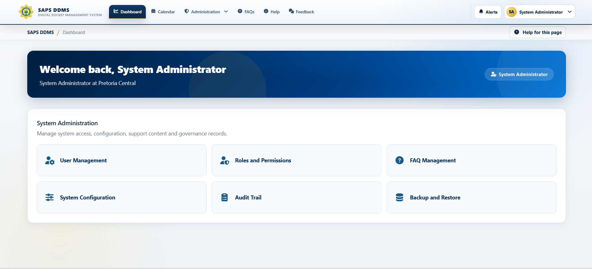
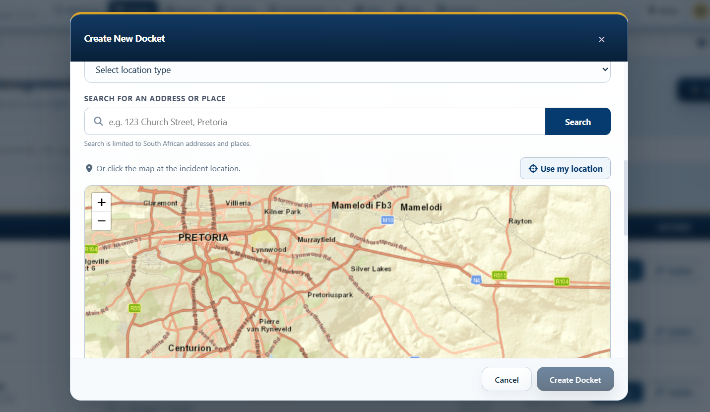
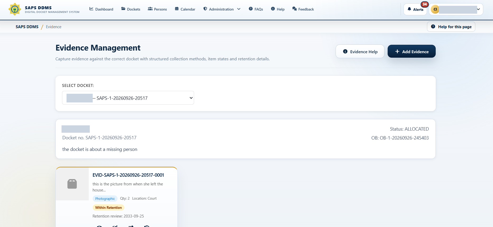
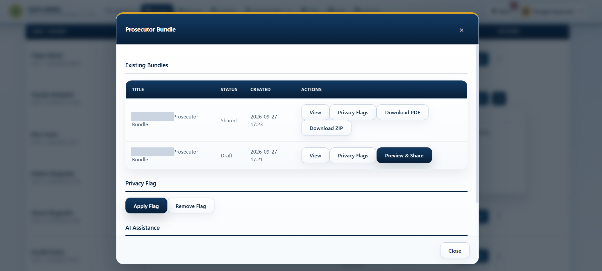
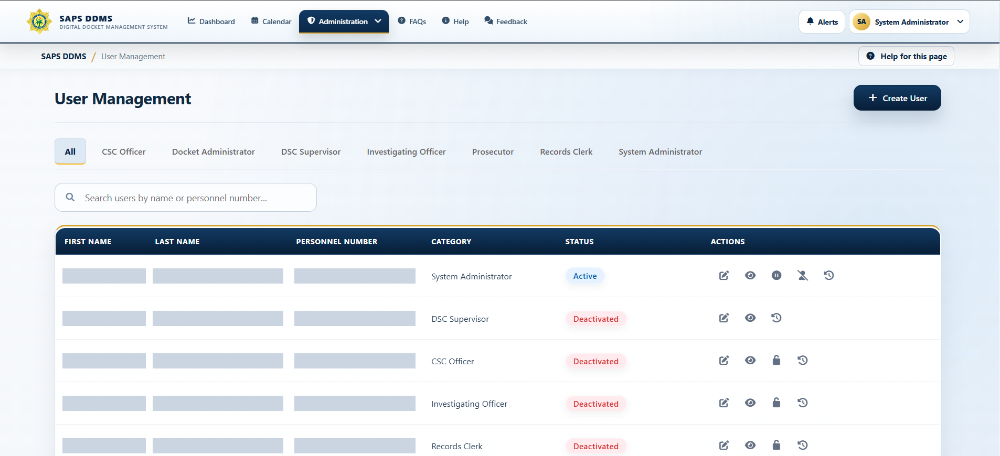
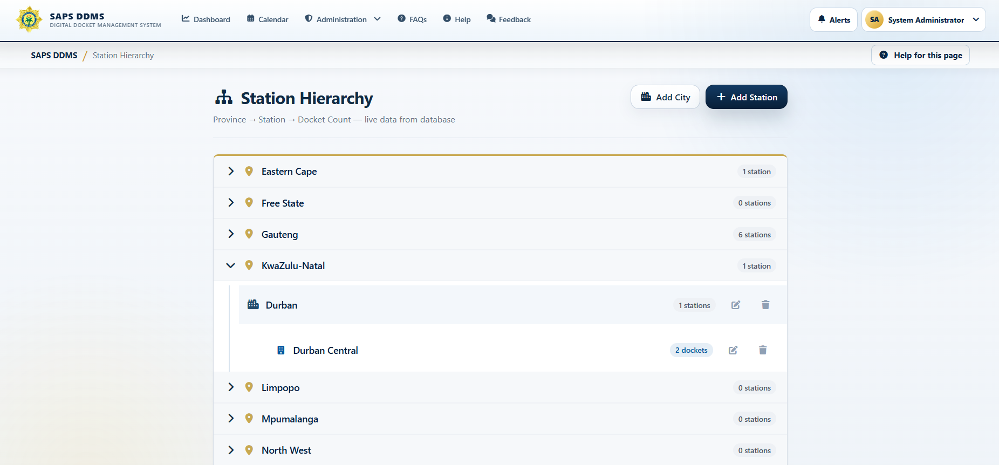

# SAPS Digital Docket Management System

SAPS DDMS is a full-stack case-management platform that replaces fragmented, paper-heavy docket processes with one secure and auditable workflow. It brings docket registration, investigation, evidence, people, court outcomes, reporting, and operational recovery into a role-based web application.

> Portfolio project: this repository demonstrates a proposed digital docket solution and is not an official public SAPS service. All demonstration information should be synthetic.

## Overview

Paper files and disconnected systems make it difficult to know who owns a docket, where evidence is stored, which actions were taken, and whether deadlines were met. SAPS DDMS gives authorized personnel a shared operational record with controlled access, validation, audit history, and recovery tools.

The solution contains three projects:

| Project | Purpose | Documentation |
| --- | --- | --- |
| `SAPS.DDMS.Frontend` | Responsive Angular client for operational users | [Frontend README](SAPS.DDMS.Frontend/README.md) |
| `SAPS.DDMS.API` | ASP.NET Core API, business rules, persistence, reporting, and backup/restore | [API README](SAPS.DDMS.API/README.md) |
| `SAPS.DDMS.API.Tests` | Automated backend use-case and contract tests | [Tests README](SAPS.DDMS.API.Tests/README.md) |

## Features

- Secure sign-in, account activation, password reset, optional OTP, lockout, and inactivity timeout
- Role-based workflows for administrators, supervisors, investigators, evidence officers, and other operational users
- Docket registration, allocation, acceptance, reassignment, rejection controls, sensitivity levels, and lifecycle history
- Investigation notes, attachments, linked people, evidence records, and chain-of-custody transfers
- Prosecutor bundles, privacy flags, court outcomes, closure, reopening, and configurable archiving
- Dashboards, calendars, station hierarchy, workload reports, crime trends, status graphs, and PDF exports
- Audited ZIP backup packages with transactional database and managed-upload restore
- Configurable SLA, archive, session, notification, and workload settings

## Screenshots

| Secure sign-in | System Administrator dashboard |
| --- | --- |
|  |  |

| Docket location picker | Docket actions and allocation |
| --- | --- |
|  |  |

| Evidence management | Prosecutor bundles |
| --- | --- |
|  |  |

| User management | Station hierarchy |
| --- | --- |
|  |  |

See the [frontend screenshot gallery](SAPS.DDMS.Frontend/README.md#screenshot-gallery) for the full docket-creation sequence and person management. Visible names, personnel identifiers, and contact details have been covered in these captures. They show the application interface, not a production deployment; review the remaining case content before publishing the repository.

## Technologies

| Layer | Technologies |
| --- | --- |
| Frontend | Angular 21, TypeScript, Angular Material/CDK, Bootstrap, Chart.js, Leaflet, RxJS |
| Backend | C#, ASP.NET Core 8 Web API, Entity Framework Core 8 |
| Database | Microsoft SQL Server |
| Authentication | JWT, BCrypt password hashing, role and permission policies |
| Reports | QuestPDF, ScottPlot |
| Testing | xUnit, Vitest, Angular testing utilities, EF Core InMemory |
| Deployment | Docker Compose, Nginx, environment-based configuration |

## My contribution

Although this was presented as a group project, I personally coded the entire system. I completed the frontend, backend API, database design and integration, automated testing, debugging, and portfolio-ready delivery. My work included:

- Implementing reliable full backup creation and transactional restore, including managed uploads and session invalidation
- Refining docket allocation, reassignment, unallocation, rejected-docket restrictions, and sensitivity handling
- Improving crime-trend, docket-status, workload, and transactional reports
- Adding validation for court dates and date of birth against South African ID numbers
- Making station-tree data and archive/session policies configurable
- Improving responsive UI behavior, role-aware navigation, error handling, and demonstration readiness
- Expanding automated verification and preparing the repository for safe public portfolio use

## Setup

### Prerequisites

- Git
- .NET 8 SDK
- Node.js 20 or later with npm
- SQL Server 2019 or later, including SQL Server Express

### Install dependencies

```powershell
git clone <repository-url> SAPS-DDMS
cd SAPS-DDMS
dotnet tool restore
dotnet restore SAPS-DDMS.sln
cd SAPS.DDMS.Frontend
npm ci
cd ..
```

### Configure the database and secrets

Committed configuration contains no credentials. Store development values in .NET user secrets:

```powershell
$connection = 'Server=.\SQLEXPRESS;Database=SAPS.DDMS;Trusted_Connection=True;TrustServerCertificate=True;MultipleActiveResultSets=True'
$jwtKey = [Convert]::ToBase64String([Security.Cryptography.RandomNumberGenerator]::GetBytes(48))

dotnet user-secrets set 'ConnectionStrings:DefaultConnection' $connection --project SAPS.DDMS.API
dotnet user-secrets set 'JwtSettings:SecretKey' $jwtKey --project SAPS.DDMS.API
dotnet ef database update --project SAPS.DDMS.API --startup-project SAPS.DDMS.API
```

See the [complete setup guide](docs/SETUP.md) for SQL authentication and troubleshooting.

### Run the application

Start the API:

```powershell
dotnet run --project SAPS.DDMS.API
```

Start the frontend in another terminal:

```powershell
cd SAPS.DDMS.Frontend
npm start
```

Open `http://localhost:4200`.

## Verification

```powershell
dotnet test SAPS.DDMS.API.Tests --configuration Release
cd SAPS.DDMS.Frontend
npm test -- --watch=false
npm run build
npm audit
```

The latest portfolio verification passed 21 backend tests, 137 frontend tests, the production Angular build, and npm audit with zero known vulnerabilities.

## Deployment and data safety

Use `.env.production.example` with [the deployment guide](docs/DEPLOYMENT_GUIDE.md). Never commit databases, backup packages, uploaded evidence, user exports, access tokens, or real operational information. Review [production readiness](docs/PRODUCTION_READINESS.md) before any live deployment.
