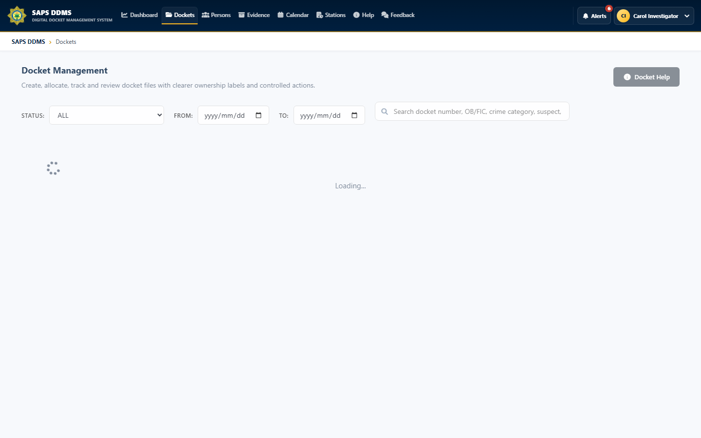

# SAPS DDMS API Tests

## Overview

This project contains automated tests for the SAPS DDMS backend. It protects the workflows where a regression could expose data, permit an invalid action, or leave a docket in an inconsistent state.

The tests run without production data or a live SQL Server by using focused test doubles and EF Core's in-memory provider where persistence behavior is required.

## Features

- Authentication input normalization, login behavior, password reset, and session rules
- Controller authorization contracts for protected endpoints
- Prosecutor-bundle privacy behavior
- Court outcome validation and workflow transitions
- Person creation, validation, search, update, and controller behavior
- Server-side validation of sensitive or invalid requests

The current suite contains 21 passing backend tests across the use-case test classes in `UseCaseTests`.

## Technologies

- .NET 8
- xUnit
- Microsoft.NET.Test.Sdk
- Entity Framework Core InMemory
- Hand-written service and repository test doubles

## Screenshots

The test project has no standalone user interface. It validates the API behavior behind application workflows such as the docket-management screen below.



## My contribution

My work included adding and maintaining regression coverage for the authentication, authorization, person, prosecutor-bundle, court-outcome, and server-validation behavior changed during the portfolio hardening work. These tests provide fast feedback without requiring operational records.

## Setup and execution

From the repository root:

```powershell
dotnet restore SAPS-DDMS.sln
dotnet test SAPS.DDMS.API.Tests --configuration Release
```

Run one test class while developing:

```powershell
dotnet test SAPS.DDMS.API.Tests --filter FullyQualifiedName~CourtOutcomeTests
```

Build and test outputs are generated under `bin` and `obj` and are intentionally excluded from source control.
