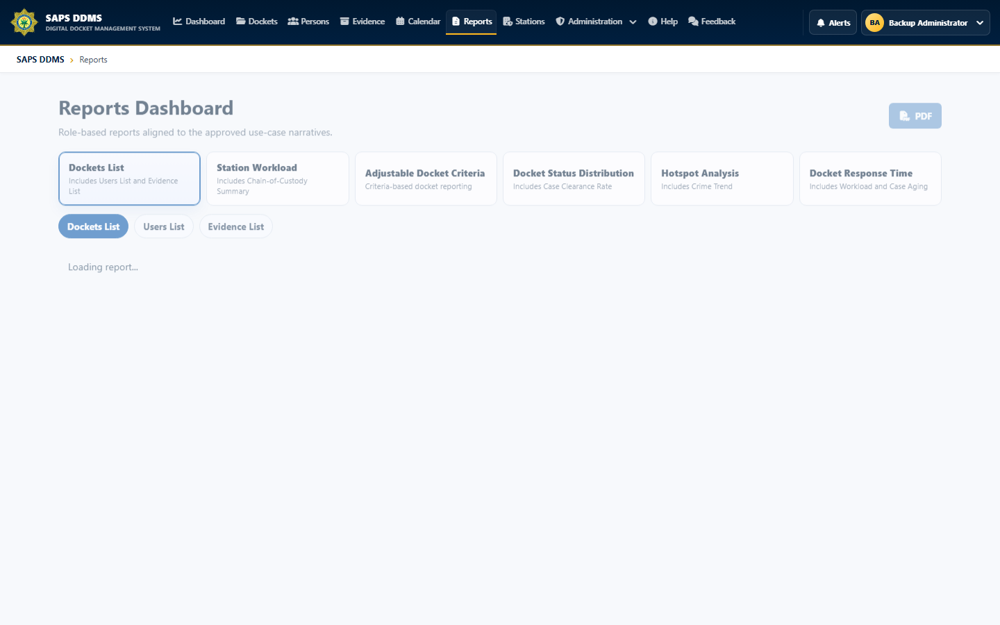

# SAPS DDMS API

## Overview

This project is the ASP.NET Core backend for SAPS DDMS. It centralizes operational business rules and exposes secure APIs for the Angular client. The API solves the consistency and accountability problems created when docket information, evidence movements, deadlines, and user actions are managed independently.

## Features

- JWT authentication, BCrypt password hashing, account activation, reset, lockout, OTP, and sessions
- Role and permission enforcement at API boundaries
- Docket registration, allocation, reassignment, status history, sensitivity, archive, and court workflows
- Investigation notes, attachments, linked people, evidence, and chain-of-custody transfers
- Prosecutor bundles, privacy controls, notifications, audit trails, and configurable operational rules
- Dashboard queries, report datasets, chart/PDF generation, and data exchange
- Validated snapshot packages with transactional table restore, managed-upload rollback, and session invalidation
- SQL Server migrations plus operational schema/reference-data bootstrap checks

## Technologies

- C# and ASP.NET Core 8 Web API
- Entity Framework Core 8 with Microsoft SQL Server
- JWT bearer authentication and BCrypt.Net
- QuestPDF and ScottPlot for report output
- MailKit/MimeKit for email integration
- Swagger/OpenAPI for development-time API exploration
- Docker for deployment

## API areas

| Area | Responsibilities |
| --- | --- |
| Authentication | Login, activation, OTP, password reset, sessions |
| Dockets | Registration, assignment, status, sensitivity, court outcomes |
| Investigation | Notes, attachments, people, evidence, custody transfers |
| Administration | Users, roles, stations, settings, SMS queue, audit history |
| Reporting | Operational datasets, charts, PDF exports, calendars |
| Recovery | Backup creation, download, validation, and transactional restore |

## Screenshots

The API powers the role-based reports interface shown below:



## My contribution

My backend work focused on workflow integrity and operational reliability. I implemented or refined transactional backup/restore, assignment and reassignment rules, sensitivity handling, court/date/identity validation, configurable archive and session policies, report queries, authorization boundaries, audit recording, and related regression tests.

## Setup

From the repository root, restore tools and packages:

```powershell
dotnet tool restore
dotnet restore SAPS-DDMS.sln
```

Configure local secrets:

```powershell
$connection = 'Server=.\SQLEXPRESS;Database=SAPS.DDMS;Trusted_Connection=True;TrustServerCertificate=True;MultipleActiveResultSets=True'
$jwtKey = [Convert]::ToBase64String([Security.Cryptography.RandomNumberGenerator]::GetBytes(48))

dotnet user-secrets set 'ConnectionStrings:DefaultConnection' $connection --project SAPS.DDMS.API
dotnet user-secrets set 'JwtSettings:SecretKey' $jwtKey --project SAPS.DDMS.API
dotnet ef database update --project SAPS.DDMS.API --startup-project SAPS.DDMS.API
```

Run the API:

```powershell
dotnet run --project SAPS.DDMS.API
```

Configuration files contain placeholders only. Production connection strings, JWT keys, SMTP credentials, and SMS provider secrets must come from environment variables or a secrets manager.

## Verification

```powershell
dotnet test SAPS.DDMS.API.Tests --configuration Release
```

See the [test-project README](../SAPS.DDMS.API.Tests/README.md) for covered use cases and the [production-readiness guide](../docs/PRODUCTION_READINESS.md) before deployment.
