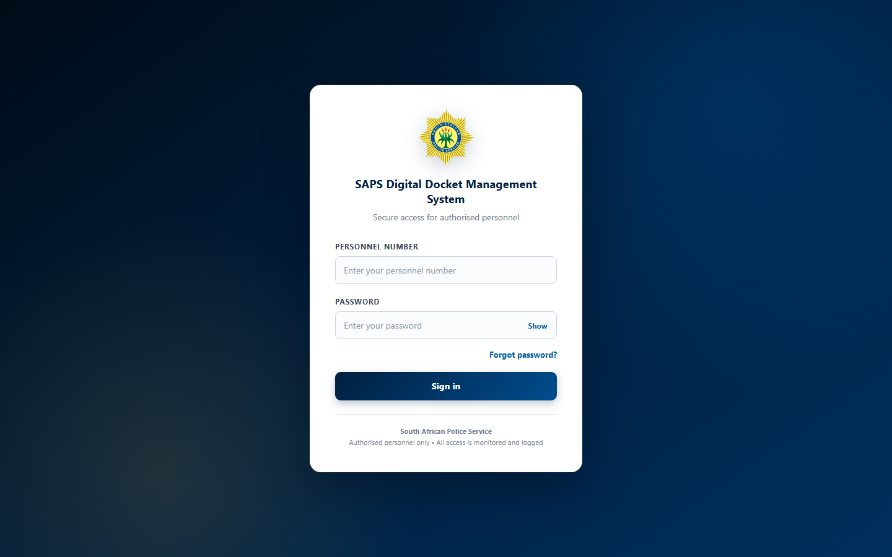
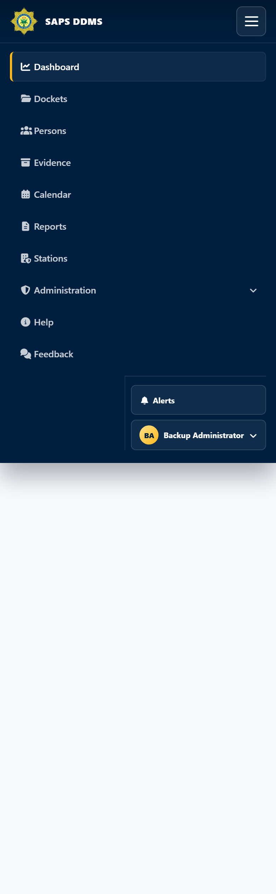

# SAPS DDMS Angular Client

## Overview

This project is the responsive web interface for SAPS DDMS. It turns complex docket, evidence, investigation, administration, and reporting workflows into role-aware screens that work on desktop and smaller displays.

The client solves two usability problems: operational users should see only the actions relevant to their role, and complex case information should remain searchable and understandable without navigating separate systems.

## Features

- Secure sign-in, account activation, password recovery, optional OTP, and automatic inactivity handling
- Lazy-loaded, role-protected routes and permission-aware navigation
- Docket creation, filtering, allocation, reassignment, sensitivity, court outcome, and archive workflows
- Investigation notes, people, evidence, and chain-of-custody interfaces
- Dashboards, reports, charts, calendars, editable station hierarchy, and PDF export actions
- Administration for users, roles, system settings, audit history, SMS queue, and backup/restore
- Responsive navigation, form validation, accessible dialogs, loading states, and API error feedback

## Screenshots

| Sign-in | Docket management |
| --- | --- |
|  |  |

| Reports | Mobile navigation |
| --- | --- |
|  |  |

## Technologies

- Angular 21 and TypeScript 5.9
- Angular Router, Material, and CDK
- RxJS and Angular HTTP client
- Bootstrap and Font Awesome
- Chart.js for report visualizations
- Leaflet for geographic views
- Vitest, jsdom, and Angular testing utilities
- Nginx and Docker for production hosting

## My contribution

My frontend work focused on connecting the operational requirements to usable, role-aware screens. This included docket reassignment and sensitivity controls, report presentation fixes, editable station-tree behavior, court and identity validation feedback, inactivity handling, backup/restore UX, responsive navigation, and automated component/service tests.

## Setup

From this directory:

```powershell
npm ci
npm start
```

Open `http://localhost:4200`. The development proxy in `proxy.conf.json` forwards `/api` requests to the ASP.NET Core API.

For the complete database and API setup, see the [repository setup guide](../docs/SETUP.md).

## Verification

```powershell
npm test -- --watch=false
npm run build
npm audit
```

Generated folders such as `node_modules`, `.angular`, `dist`, and coverage output are intentionally excluded from source control.
